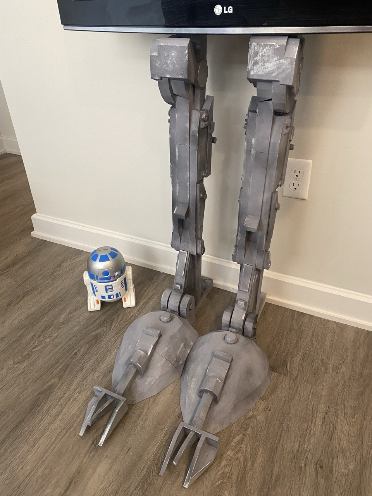
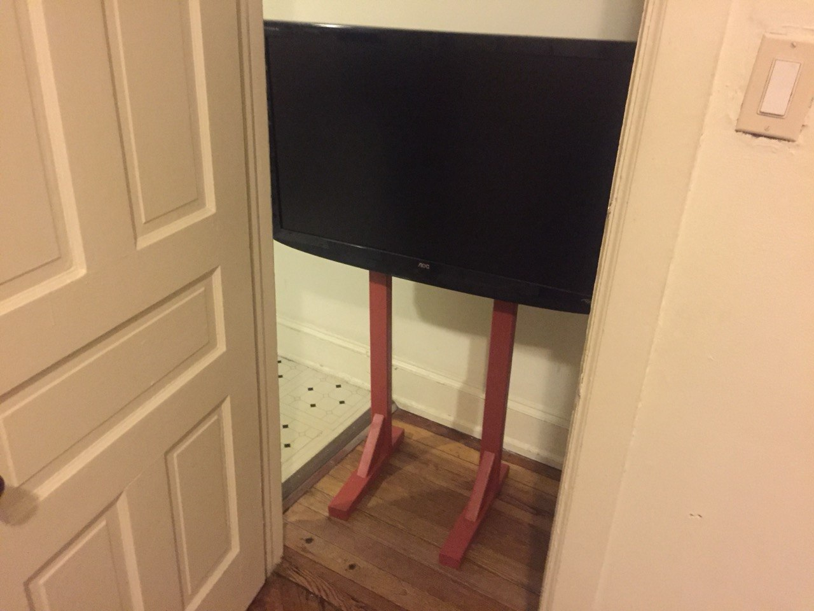
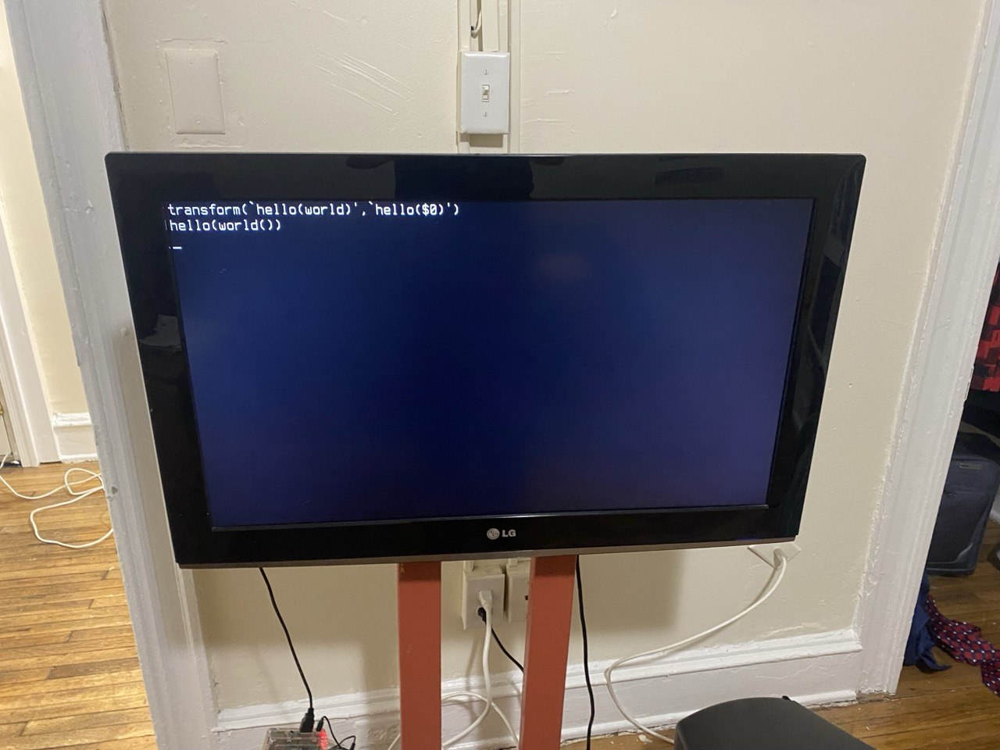
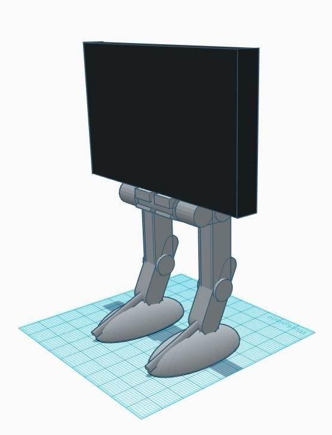
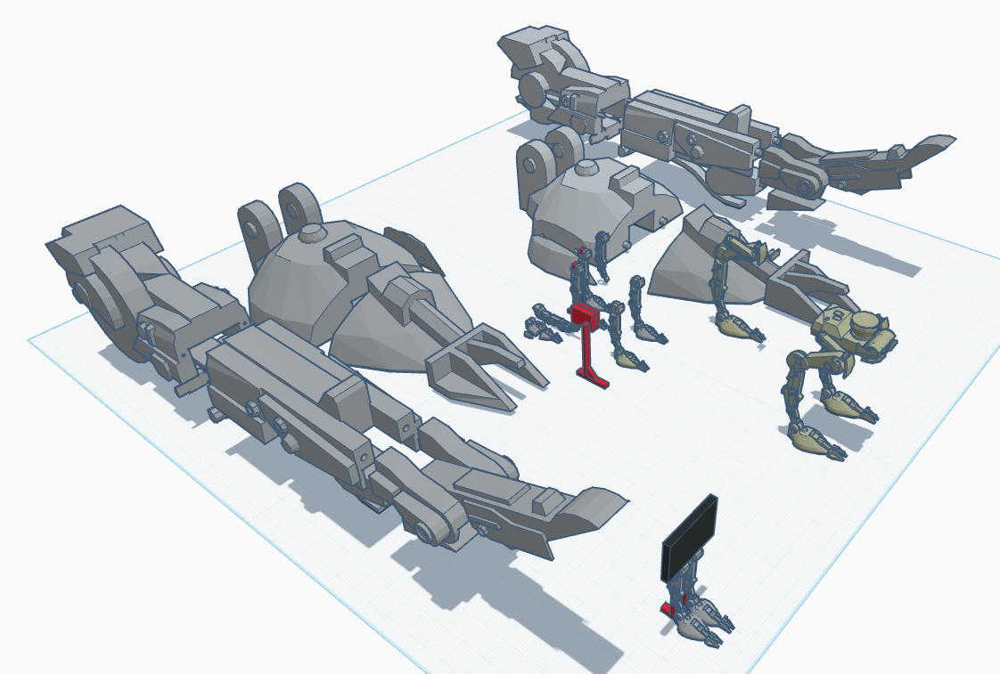
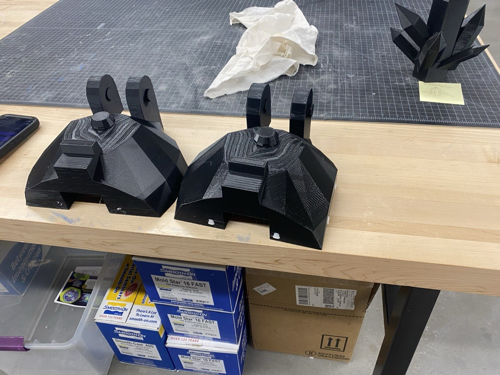
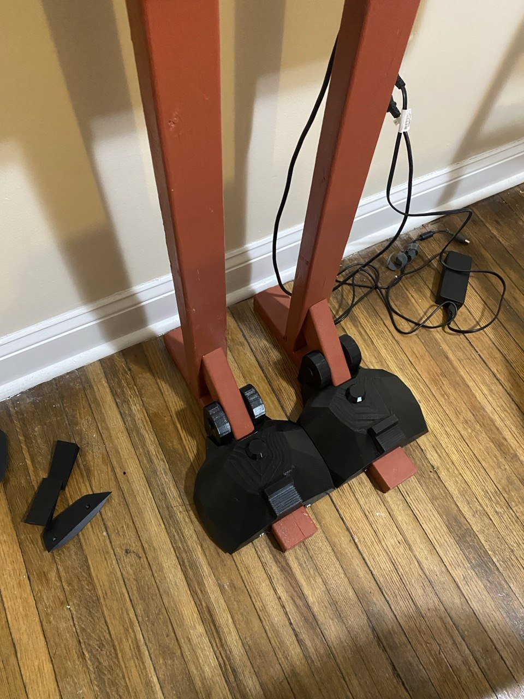
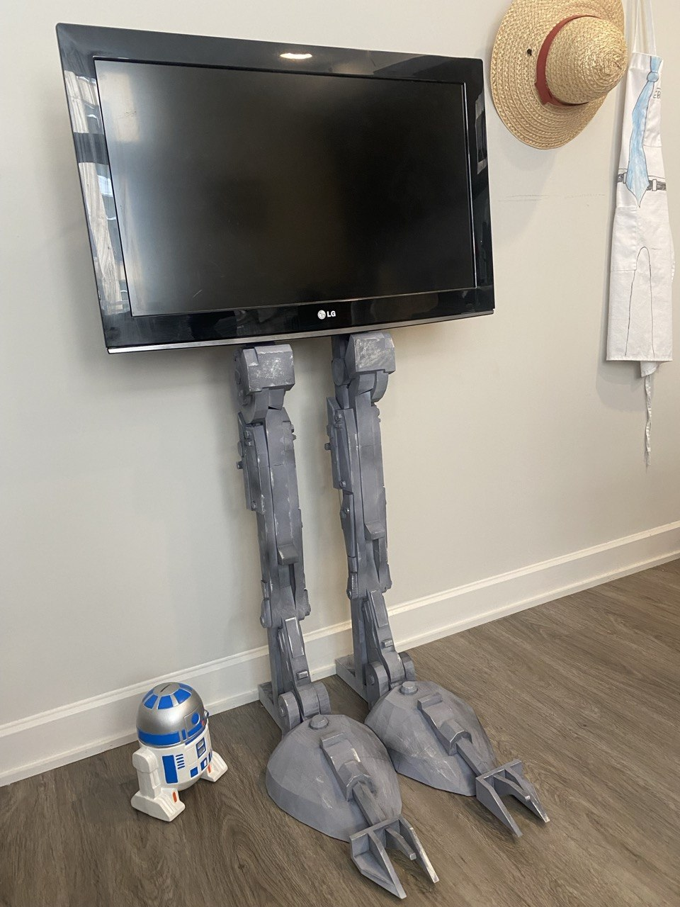
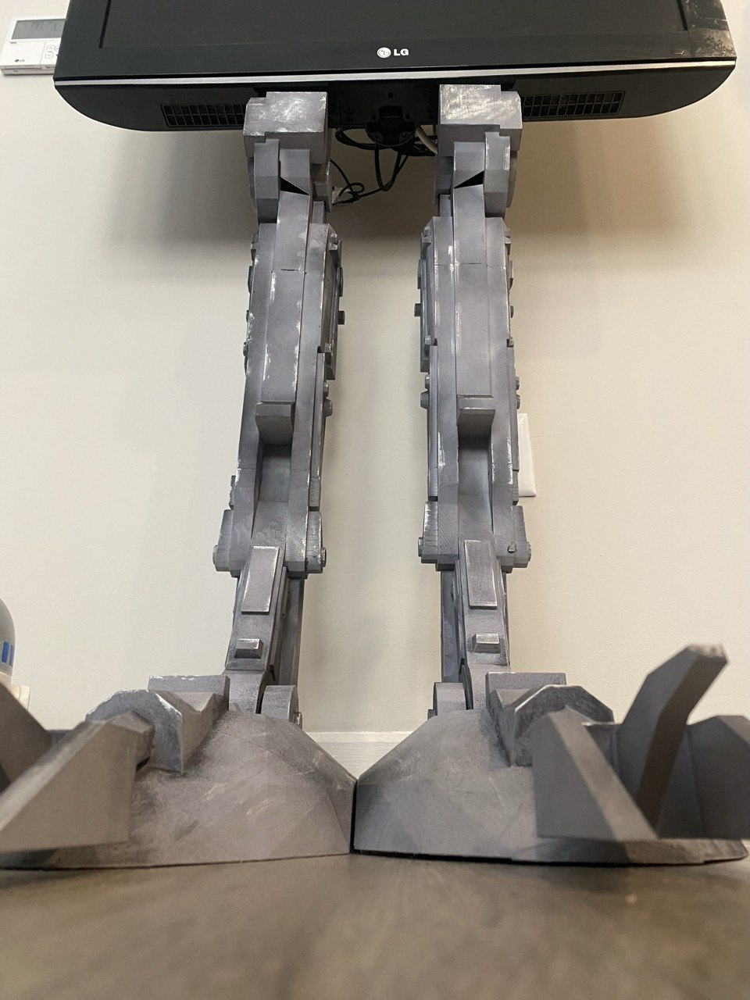

# AT-TV

I moved 4 times in grad school; I wanted to try out different parts of the beautiful city of Philadelphia!  This went hand-in-hand with my minimalist lifestyle.  I didn't have a media console, no entertainment center, certainly no credenza.  But I was getting too old to have my TV on the floor.  What was I to do?

I had an idea: legs for the TV!  My dad knew exactly how to do it.  We went into the backyard and used the mobile table saw to cut up some 2x4s.  We painted them red, and after some clever bolt engineering on my dad's part, we had two VESA-compatible TV legs!

I've moved many times with those legs and it's been very convenient.  But from the early days of the legs, they were calling for something more.

The TV wanted to look like an AT-ST from Star Wars Episode V: The Empire Strikes Back and Episode VI: Return of the Jedi (and The Mandalorian and Rebels and Jedi: Fallen Order and Battlefront and the LEGO games and everywhere else they show up).  I did some quick doodling in Tinkercad, and let that vision sit for years.

Once I started going to Penn's makerspace, I had access to their dual-extrusion 3D printer which supports soluble support.  It could print 1' cubes and the staff were excited to see the Star Wars legs, or the _AT-TV_, become a reality.

I didn't trust printed plastic to hold up a TV, so I planned to print a plastic shell for the existing wooden legs.

I searched for AT-ST 3D models online meeting two criteria:
 - a straight leg and
 - a thick leg.
These desiderata would make it easier to fit the existing legs inside the model.  I found [Jace1969's conversion of a retracted FacePunch model](https://www.printables.com/model/23661-sw-atst), which fit the bill.  This model is also relatively low-poly.

I went back to Tinkercad with this model, added a cavity for the existing legs, and chopped it up into 1' cubes.

The prints took weeks to get through the queue, but the quality was wonderful for the size.

The legs were great, but the color was off.  I brought the shell pieces home for a holiday and my dad cut new 2x4 legs, screwed the shell to those legs, and spray painted the whole thing gray.  I used the legs like this for a while; it looked like LEGOs.

The legs were still asking for more.  There are gorgeous plastic models of AT-STs out there, including, I suppose, the originals from the movies.  Even standard scale-model weathering techniques would make my TV legs look so much better.  I hadn't done any weathering before, but I'm always down to learn something new.

I bought two tones of gray spray paint.  I fully coated the legs in the lighter gray and lightly sprayed the darker from a distance to create the metal effect.  I applied shiny silver modeling paint with a rag at the edges to simulate paint chipping.  Finally, I applied big drops of a black modeling paint in certain creases and let them run like an oil leak.

I'm very happy with how they turned out!

Thank you, Dad, for all of your help!
